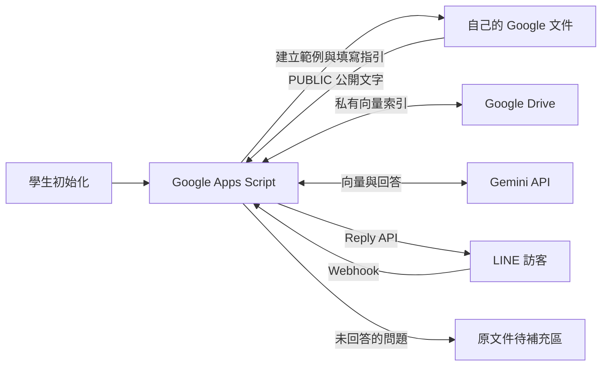

# ResumeRAGbot

用 **Google Apps Script（GAS）＋Google 文件＋Gemini API** 建立 LINE 互動履歷，供學生安裝、修改與測試。每位學生使用自己的帳號與 API 設定，不需要 Cloudflare 或外部向量資料庫。

第一次執行 `initializeProject`，會在學生自己的 Google Drive **自動建立含填寫指引及完整模擬履歷的文件**，並設定文件 ID 與分頁 ID。學生不必面對空白文件，也不用手動找 ID。

## 學生從這裡開始

- **[詳細安裝說明](docs/部署指南.md)**：瀏覽器操作，不必安裝 Node.js、Git 或 clasp。
- **[履歷填寫指南](docs/履歷填寫指南.md)**：怎麼把範例改成自己的內容、學生專題範例與 AI 整理提示詞。
- [安裝勾選清單](docs/開始使用.md)：逐步核對。
- [課堂實作與驗收](docs/課堂實作.md)：已知問題、未知問題、資料更新及維護練習。
- [開發與 clasp 指南](docs/開發指南.md)：修改程式及本機測試。

## 安裝流程

1. 建立自己的 GAS 專案，貼入 [單檔程式 dist/Code.gs](dist/Code.gs) 與 [manifest](gas/appsscript.json)。
2. 執行 `initializeProject` 並授權，從執行記錄的 `documentUrl` 打開自動建立的履歷。
3. 建立 LINE Messaging API 頻道及 Gemini API Key，填入 GAS 指令碼屬性。
4. 執行 `syncKnowledgeBase`、`checkSetup` 與 `testResumeAnswer`。
5. 部署為以「我」執行、「所有人」可存取的網頁應用程式，將正式 `/exec` 網址填入 `WEB_APP_URL`。
6. 執行 `showWebhookUrl`，把完整結果貼到 LINE Webhook URL，開啟 Use webhook，再加入好友測試。

GitHub 存放原始碼；機器人執行在學生自己的 GAS 專案。程式不內建任何人的文件、部署網址或正式金鑰。

## 功能

| 功能 | 行為 |
| --- | --- |
| 自動建立履歷 | 首次初始化建立指引及虛構範例，重複執行不覆蓋既有內容 |
| LINE 主題選單 | 個人介紹、技能、工作經歷、專案、聯絡方式 |
| RAG 問答 | 公開文字分段、768 維向量、混合排序、前五段檢索與來源引用檢查 |
| 等待提示 | 請求 LINE 顯示處理中動畫 |
| 待補充問題 | 資料不足時寫回原文件，同題合併次數，保留主人註記 |
| 更新同步 | 手動或每小時同步；來源改動後停止引用舊索引 |
| 錯誤說明 | 區分 API 配額、權限、服務錯誤及 AI 回答檢查失敗 |
| 問答次數 | 不設程式自訂的每日／每小時額度，供應商限制仍適用 |



## 履歷格式

內容不必遵守固定欄位；使用自然段落、標題或條列都可以。需保留獨立成行的 `[[PUBLIC]]` 與 `[[/PUBLIC]]`，只有中間的文字會供 RAG 使用。字型與顏色不影響文字讀取，圖片及外部連結內容不會自動解析。

沒有工作經驗也能用課程專題、社團或志工經驗。請看 [履歷填寫指南](docs/履歷填寫指南.md)。內建的 [完整範例](docs/模擬履歷_陳沐言_AI自動化工程師.txt) 全是虛構，正式使用時應替換為自己的真實資料。

「待補充問題」是維護清單，不是履歷事實。主人確認後，將可公開的答案補進公開區，再執行 `syncKnowledgeBase`。

## 使用範圍

本專案適合教學與小量一對一文字問答。GAS Web App 事件不提供 LINE 簽章標頭，這版以秘密 Webhook 網址保護入口，**無法驗證 X-Line-Signature**，不等同 LINE 官方建議的簽章驗證。需要嚴格驗證的服務須另設可讀取標頭的入口。[GAS 事件介面](https://developers.google.com/apps-script/guides/web) · [LINE 簽章驗證](https://developers.line.biz/en/docs/messaging-api/verify-webhook-signature/)

AI 呼叫同步完成，服務延遲可能超過 LINE 回覆期限；沒有自動 Push 補答。每題獨立回答，沒有對話記憶。引用檢查不能保證每句答案皆正確，仍需對照履歷驗收。

公開區塊與提問會交給 Gemini，未回答的問題會保存到履歷主人的文件。來源文件與索引不必公開。請先用虛構資料練習，費用及平台限制見 [安裝說明](docs/部署指南.md)。

## 本機開發

需要 Node.js 22 以上；瀏覽器安裝不需要這些指令。

```sh
npm ci
npm run check
npm test
npm run bundle
npm run check:bundle
npm run check:docs
```

本機測試模擬 Google、Gemini 與 LINE，不使用真實金鑰、不消耗配額、不發送訊息。測試成功不代表帳號授權與 LINE 部署已正確，仍須完成實機驗收。

`gas/` 是八個分檔原始碼，`dist/Code.gs` 是可直接複製的單檔版本。修改分檔後執行 `npm run bundle`。安裝時擇一，不要重複貼入。

## 授權

[MIT License](LICENSE)。可用於教學、修改與分享，散布時保留授權文字。模擬人物、公司與成果不代表作者或使用者的真實經歷。
