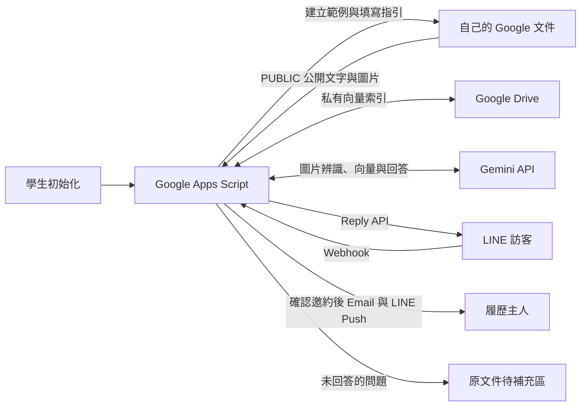

# ResumeRAGbot

用 **Google Apps Script（GAS）＋Google 文件＋Gemini API** 建立 LINE 互動履歷，供學生安裝、修改與測試。每位學生使用自己的帳號與 API 設定，不需要 Cloudflare 或外部向量資料庫。

第一次執行 `initializeProject`，會在學生自己的 Google Drive **自動建立含填寫指引及完整模擬履歷的文件**，並設定文件 ID 與分頁 ID。學生不必面對空白文件，也不用手動找 ID。

目前安裝請使用 **第二版 v2.0.0（2026-10-26）**，已整合今天完成的全部功能。上週的第一版（2026-10-19）只作歷史保留，今天的中間測試發布已整併。已安裝舊版請先看 [保留資料的升級步驟](docs/版本更新.md)。

## 學生從這裡開始

- **[下載最新安裝包](https://github.com/canlgz/ResumeRAGbot/releases/latest)**：全部解壓縮後，用瀏覽器開啟資料夾裡和 README.md 放在一起的 **START_HERE.html**，按鈕可複製程式與 manifest，逐階段確認結果。
- **[詳細安裝說明](docs/部署指南.md)**：瀏覽器操作，不必安裝 Node.js、Git 或 clasp。
- **[履歷填寫指南](docs/履歷填寫指南.md)**：怎麼把範例改成自己的內容、學生專題範例與 AI 整理提示詞。
- **[圖片知識庫](docs/圖片知識庫.md)**：插入作品介面、設計海報或照片，同步辨識圖片文字、構圖、配色與可見元件。
- **[作品卡片與圖片校對](docs/作品卡片與圖片校對.md)**：主人校正辨識結果、選擇公開作品預覽、接續追問，以及自動代表主題選單。
- **[聯繫與邀約通知](docs/聯繫與邀約通知.md)**：Doc Email、Google 寄信授權、LINE Your user ID 設定、實際收件與排錯。
- [安裝勾選清單](docs/開始使用.md)：逐步核對。
- **[安裝後延伸思考](docs/安裝後延伸思考.md)**：未來 v3.0 的職缺對照提案與設計因素，供自行思考與評估；尚未實作。
- [開發與 clasp 指南](docs/開發指南.md)：修改程式及本機測試。
- [學生安裝檢查紀錄](docs/學生安裝檢查.md)：實際下載、瀏覽器測試、重現問題與修正範圍。

## 安裝流程

開始前：建議使用年滿 18 歲的個人 Gmail。Gemini API 條款要求年滿 18 歲，學校帳號也可能無法使用 AI Studio 或開放 Web App 給所有人，詳見 [準備帳號](docs/部署指南.md#0-準備帳號)。

1. 建立自己的 GAS 專案，貼入 [單檔程式 dist/Code.gs](dist/Code.gs) 與 [manifest](gas/appsscript.json)。
2. 儲存 manifest 後，從左側檔案欄點回「程式碼.gs／Code.gs」，在上方函式下拉選單選 `initializeProject` 並執行；授權時勾「選取全部」，再從記錄的「履歷文件：」網址打開自動建立的履歷。
3. 建立 LINE Messaging API 頻道及 Gemini API Key。在「專案設定 → 指令碼屬性」按「編輯指令碼屬性」，新增兩個金鑰，必要時修改姓名備援值 `DISPLAY_NAME`，再按「儲存指令碼屬性」。
4. 依序執行 `testLineConnection`、`checkSetup`、`syncKnowledgeBase`、`checkSetup` 與 `testResumeAnswer`。
5. 「部署 → 新增部署作業」，點「選取類型」旁的齒輪選網頁應用程式，以「我」執行、「所有人」可存取，將正式 `/exec` 網址填入 `WEB_APP_URL`。執行 `checkDeployment`，確認編輯器及正式網址版本相同、`status=ready`。
6. 執行 `showWebhookUrl`，把完整結果貼到 LINE Webhook URL，開啟 Use webhook、關閉自動回應，再掃 QR Code 加入好友測試。

7. 在 Doc 填入實際 Email，執行 `enableInvitationEmailNotifications` 完成寄信授權並收到測試信；設定 `OWNER_LINE_USER_ID` 為本頻道 Basic settings 的 Your user ID。加入自己的 bot 為好友，用「留下邀約 → 確認送出」驗收 Email 與 LINE 通知。

GitHub 存放原始碼；機器人執行在學生自己的 GAS 專案。程式不內建任何人的文件、部署網址或正式金鑰。

## 今天第二版新增了什麼

第二版把第一版的文字履歷問答，擴充成能看作品、接續交流與接收邀約的互動履歷。以下均已包含在 **v2.0.0**，只要安裝一包，不必逐項下載。

| 新增／改善 | 使用方式與具體效果 |
| --- | --- |
| **圖片也能 RAG 搜尋** | 在 Doc 公開區插入網站介面、海報等圖片並同步；圖片中的文字、構圖、配色與可見元件都能成為回答來源 |
| **作品圖文卡片** | 主人逐張開放獨立圖片副本；訪客輸入「作品圖庫」，可看作品、查看原圖及選擇「問這件作品」 |
| **圖片辨識校對** | 主人執行 `openImageReview`，在管理頁對照原圖修改辨識，再儲存並同步；校對資料另存，不塞進 Doc |
| **短期對話記憶** | 選一件作品後可接續問「這張配色呢」；約 10 分鐘內沿用指向，輸入「清除對話」重設，切換主題會重新選對來源 |
| **三張精簡首頁卡** | 第一張介紹／肖像／聯繫，第二張個人特質，第三張主題導覽；輸入「首頁」「選單」「回首頁」隨時開啟 |
| **沿用 Doc 肖像** | 同步時準備公開介紹中肖像的獨立預覽；沒放肖像時使用幾何人物，不修改原文件 |
| **有類型的 Quick Reply** | 固定「我是誰」「快速一覽」，加最多四個「類型：主題」，如「專案：知識助理」「作品：海報設計」；依內容同步產生並沿用同一份 |
| **配合交流目的的貼圖** | 招呼、能力評估、成果、關注、致謝與釐清使用合適貼圖；同一意圖短時間內不重複，細節、資料不足與錯誤保留文字 |
| **聯繫本人與邀約** | 「想約面試」「想合作」可叫出聯繫卡；Email 旁有小複製圖示，也可點信箱取得純文字；「在 LINE 留邀約」確認後才保存 |
| **Email ＋ LINE 雙通知** | 邀約確認後，通知到 Doc 信箱與 `OWNER_LINE_USER_ID` 指定的本人 LINE，附完整邀約與回覆方式，平常不必進 GAS 查看 |
| **私人邀約收件匣** | 需要整理時執行 `openInvitations`，可查看通知狀態、標記已處理或刪除；內容不寫入 Doc、不交給 AI |
| **更新與安裝診斷** | `checkDeployment` 核對編輯器與正式部署，版本不同時保留索引；指南寫清楚新增寄信授權、userId 與保留資料的升級步驟 |

第一版的自動建立履歷、公開範圍、文字 RAG、等待提示、待補充問題及 API 錯誤說明繼續保留。程式沒有另外設定每日／每小時問答次數上限，平台本身的額度仍適用。回覆保留來源文字；「展開答案依據」按鈕已取消。

## 未來 v3.0：延伸思考方向

「人資貼職缺需求 → 逐項對照履歷證據 → 整理待確認條件 → 準備面談問題」是未來發展提案，**尚未實作，也沒有第三版安裝包**。學生可自行決定是否增加，先思考需求、證據、不確定性、個資、成本、等待與驗收；詳見 [安裝後延伸思考](docs/安裝後延伸思考.md)。



## 履歷格式

內容不必遵守固定欄位；使用自然段落、標題或條列都可以。需保留獨立成行的 `[[PUBLIC]]` 與 `[[/PUBLIC]]`，只有中間的文字與嵌入圖片會供 RAG 使用。圖片在同步時先轉成可搜尋文字，詳見 [圖片知識庫](docs/圖片知識庫.md)；外部連結內容不會自動追讀。

沒有工作經驗也能用課程專題、社團或志工經驗。請看 [履歷填寫指南](docs/履歷填寫指南.md)。內建的 [完整範例](docs/模擬履歷_陳沐言_AI自動化工程師.txt) 全是虛構，正式使用時應替換為自己的真實資料。

「待補充問題」是維護清單，不是履歷事實。主人確認後，將可公開的答案補進公開區，再執行 `syncKnowledgeBase`。

## 使用範圍

本專案適合教學與小量一對一文字問答。GAS Web App 事件不提供 LINE 簽章標頭，這版以秘密 Webhook 網址保護入口，**無法驗證 X-Line-Signature**，不等同 LINE 官方建議的簽章驗證。需要嚴格驗證的服務須另設可讀取標頭的入口。[GAS 事件介面](https://developers.google.com/apps-script/guides/web) · [LINE 簽章驗證](https://developers.line.biz/en/docs/messaging-api/verify-webhook-signature/)

AI 呼叫同步完成，服務延遲可能超過 LINE 回覆期限；沒有自動 Push 補答；邀約通知另使用 Push API。短期記憶只幫助確認問題指向，答案仍須有履歷證據。引用檢查及自動分類不能保證所有自然語意均正確，仍需由履歷主人核對。

公開區塊與提問會交給 Gemini，未回答的問題會保存到履歷主人的文件。來源文件與索引不必公開。作品卡片公開主人選定圖片的獨立副本，公開介紹中辨識為肖像的圖片會在同步時準備首頁預覽副本；已傳送或快取的圖片無法收回。請先用虛構資料練習，費用及平台限制見 [安裝說明](docs/部署指南.md)。

## 本機開發

需要 Node.js 22 以上；瀏覽器安裝不需要這些指令。

```sh
npm ci
npm run check
npm test
npm run bundle
npm run check:bundle
npm run check:docs
```

本機測試模擬 Google、Gemini 與 LINE，不使用真實金鑰、不消耗配額、不發送訊息。測試成功不代表帳號授權與 LINE 部署已正確，仍須完成實機驗收。

`gas/` 是 18 個分檔原始碼，`dist/Code.gs` 是可直接複製的單檔版本；`START_HERE.html` 是內含該單檔及 manifest 的安裝頁。修改分檔或 `web/image-review.html` 後執行 `npm run bundle`，會先產生 ReviewUi.gs，再更新單檔與安裝頁。安裝時擇一，不要重複貼入。

## 授權

[MIT License](LICENSE)。可用於教學、修改與分享，散布時保留授權文字。模擬人物、公司與成果不代表作者或使用者的真實經歷。
