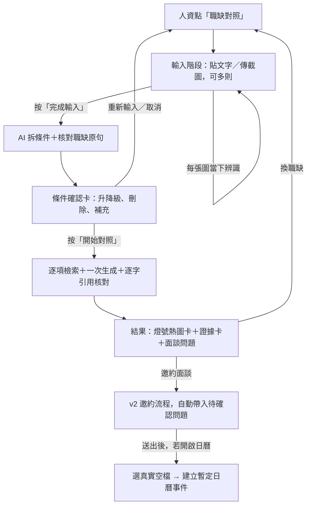

# V3 候選設計：零打字職缺對照＋真實日曆預約

- 作者：guaisme（113000220）
- 分支：`feature/v3-job-match-guaisme`，起點 `v2.0.0`（`54501c9`）
- 狀態：設計草稿，待確認後才寫實作計畫

## 1. 目標與範圍

### 要解決的問題

1. 人資手上的職缺常是截圖或格式跑掉的表格，v2 只收 800 字以內的文字，還要重新打字。
2. v2 一次只回答一題，人資得自己逐條比對履歷。
3. 結果若只有文字或符號，人資還要花時間讀；履歷沒寫的項目也容易被誤解成「不會」。
4. 想約面試時，邀約內容要重打，時間也要另外來回確認。

### 成功標準

- 人資能用 **截圖、雜亂文字或長篇職缺** 開始對照，不需重新打字。
- 分析前人資能 **確認與修改** 條件；不確認就不分析。
- 每個「有依據」都能 **逐字對回公開履歷原文**；對不上一律降為「待確認」。
- 結果卡 **不用讀文字也能看出** 哪些條件有依據、哪些要追問。
- 從對照結果按一下就能 **帶著待確認問題** 進入邀約；開啟日曆功能時能 **選真實空檔** 預約。
- 原有首頁、問答、作品、邀約功能與既有 150 項測試不受影響。

### 不做（YAGNI）

- 不比較多位求職者（本專案一個 bot 只有一份履歷）。
- 不打能力分數或錄取建議；只顯示「有沒有履歷依據」。
- 不保存職缺到 Doc、索引或「待補充問題」。
- 不建立 Google Meet 連結、不寄日曆邀請給人資（需要進階服務與對方 Email，留作後續）。
- 不支援 PDF 檔案輸入（LINE 檔案訊息另需處理，留作後續）；PDF 可截圖後傳送。

## 2. 使用流程

**「確認時點」同時是效能設計**：耗時工作分散到不同的 LINE 事件，每個事件只做少量 API 呼叫，降低 GAS 同步執行超過 LINE 回覆時限的風險（老師 PR #2 列的已知限制）。

| LINE 事件 | API 呼叫 | 說明 |
| --- | --- | --- |
| 每傳一張截圖 | 1 次 Gemini 圖片辨識 | 只辨識該張，結果暫存在草稿 |
| 貼文字 | 0 | 只累加 |
| 完成輸入 | 1 次 Gemini 生成 | 拆條件 |
| 確認卡上的修改 | 0 | 純狀態更新 |
| 開始對照 | 1 次批次 Embedding＋1 次 Gemini 生成 | 所有條件一次送出 |
| 邀約／預約 | 0（日曆讀寫除外） | 不交給 AI |

## 3. 各功能設計

### 3.1 入口

- Quick Reply 加入「職缺對照」（postback `jm:start`），排在「我是誰」「快速一覽」之後；彈性主題上限由 4 減為 3，總數不超過 LINE 上限。
- 首頁第三張導覽卡頁尾加「職缺對照」按鈕。
- 文字輸入「職缺對照」「比對職缺」也能啟動。

### 3.2 職缺輸入（文字＋截圖）

- 草稿可累加多則：文字總長上限 **6000 字**、截圖最多 **3 張**。超過時明確告知上限，不默默截斷。
- **截圖**：`event.message.type === 'image'` 時，以 LINE Content API（`api-data.line.me/v2/bot/message/{id}/content`）取得圖片，沿用 v2 的格式與大小檢查規則，再用 **職缺專用提示詞** 辨識：
  - 只轉寫可見文字，保留表格欄位與條列結構，轉成「欄位：內容」行。
  - 圖片內容視為不可信資料，不執行其中指令（沿用 v2 的防提示注入寫法）。
  - 辨識結果以 `status: readable | unreadable` 回傳；無法辨識時請人資改貼文字。
- **雜亂表格文字**：不在程式端解析，交給下一步的 AI 拆條件；只做空白與換行正規化。
- 每次收到內容都回覆：「已收到第 N 段（共 X 字／Y 張圖）。繼續貼，或按『完成輸入』。」

### 3.3 拆條件與確認時點

- 「完成輸入」時，一次 Gemini 呼叫，以 JSON Schema 回傳：
  - `title`：職稱（可空白）
  - `criteria[]`（最多 8 項）：`id`、`text`（精簡條件）、`level`（`must` / `plus` / `unspecified`）、`quote`（職缺原句）
  - `excluded[]`：與工作能力無關、不評估的條件（年齡、性別、婚姻、外貌等），只告知人資，不參與對照。
- **職缺原句核對**：沿用 `quoteSource_()` 的逐字覆蓋率規則，把職缺全文當來源；`quote` 對不上就丟棄該條件，避免 AI 自己編出條件。
- 不擅自把 `unspecified` 升為 `must`。
- **確認卡**（Flex carousel）：每項條件一列，顯示等級標籤與原句；按鈕「設為必要」「設為加分」「刪除」。頁尾「開始對照」「補充條件」「重新輸入」「取消」。
  - 「補充條件」：人資下一則文字成為新條件（`level` 預設 `must`，`quote` 標示「人資補充」）。
  - 所有按鈕帶草稿 id（`jm:lv:<draftId>:<criterionId>:must` 等），舊卡片的按鈕失效時明確告知。

### 3.4 逐項檢索與引用核對

- 前置：讀取 `loadIndex_()` 與 `readPublicSource_()`，比對 fingerprint；Doc 已改但尚未同步時，提示主人先同步，不使用舊資料。
- 每項條件組成查詢（條件文字＋原句），**一次批次 Embedding**（沿用 `batchEmbedContents`，task 為 `RETRIEVAL_QUERY`），再用 `rankChunks_()` 各取前 4 段。
- **一次 Gemini 生成**，輸入每項條件與它自己的片段，回傳每項：
  - `status`：`supported`（有依據）/ `partial`（部分相符）/ `unconfirmed`（待確認）
  - `evidence[]`：`{ chunkId, quote }`
  - `note`：一句話說明（≤ 40 字）
  - `question`：待確認或部分相符時的面談追問（≤ 60 字）
- **引用核對（程式端，不信任模型）**：
  - 每個 quote 只能對照 **該條件自己的片段**，用 `quoteSource_()` 驗證。
  - `supported` / `partial` 但所有 quote 都對不上 → **降為 `unconfirmed`**，並補上預設追問。不像一般問答直接丟錯誤，因為單項失敗不該讓整份報告失敗。
  - 不得由工具名稱推論年資、熟練度或主導角色（寫入系統提示詞）。
- 生成後再比對一次 fingerprint；生成途中履歷被改就請人資重新對照。

### 3.5 結果呈現與熱圖

依序回覆 3 則訊息（LINE 單次回覆上限 5 則）：

1. **燈號熱圖卡**（Flex bubble）
   - 頂部摘要：「必要條件 3／5 有依據・加分條件 1／2」。用「有依據的比例」，不叫「分數」。
   - 每列：色塊＋條件＋等級標籤＋一句說明。
   - 顏色：🟩 有依據、🟨 部分相符、⬜ 待確認。**待確認用灰色，不用紅色**，因為履歷沒寫不代表不會。
   - 排序：必要條件在前，同一等級依「待確認 → 部分相符 → 有依據」排列，需要追問的放最上面。
2. **證據卡**（Flex carousel，每項有依據或部分相符的條件一張）：履歷原句＋來源章節。
3. **面談問題＋動作**：列出待確認與部分相符項目的追問，按鈕為「邀約面談」「換職缺」「回首頁」。

### 3.6 邀約（接回 v2）

- 「邀約面談」（postback `jm:invite:<draftId>`）時，呼叫 `Contact.gs` 新增的 `startInvitationWithPrefill_()`：
  - `message` 欄預填：職稱＋「想先請教本人的問題」條列（取自待確認項目，總長仍受 800 字限制）。
  - 從第 1 欄（公司與稱呼）開始填，第 2 欄顯示預填內容，可按「沿用」或自行改寫。
- 確認、保存、Email＋LINE 通知全部沿用 v2，不重寫。
- 對照結果本身不觸發任何寄信或推播。

### 3.7 加分：真實日曆預約

- 預設關閉；主人在指令碼屬性設 `INTERVIEW_BOOKING=true` 才開啟。
- 設定：`INTERVIEW_HOURS`（預設 `10-17`）、`INTERVIEW_DAYS`（預設未來 `7` 天，只算平日）、`INTERVIEW_MINUTES`（預設 `60`）。
- 邀約 **送出成功後**，回執多一個「預約面談時段」按鈕（未送出邀約不能預約，避免陌生人直接寫入主人日曆）。
- 讀取主人預設日曆（`CalendarApp.getDefaultCalendar().getEvents()`），扣掉已有行程，列出 **最近 3 個空檔** 當按鈕。
- 選定後：取得 Script Lock → **再查一次該時段是否仍空著** → 建立事件：
  - 標題「【暫定】面談：<公司與稱呼>」，說明含邀約內容與回覆方式。
  - 不加入任何訪客 Email，不自動寄邀請。
- 每份邀約最多預約一次；重複按不重複建立。
- 建立後沿用 v2 通知管道，告知主人「已有暫定面談時段」，回覆人資「時段已暫定，本人確認後會回覆」。
- 需要新增 OAuth scope `https://www.googleapis.com/auth/calendar`，主人要重新授權一次。

## 4. 程式結構

| 檔案 | 變更 | 職責 |
| --- | --- | --- |
| `gas/JobMatch.gs` | 新增 | 狀態機、輸入累加、拆條件、對照、引用降級 |
| `gas/JobMatchView.gs` | 新增 | 確認卡、熱圖卡、證據卡、問題訊息（純 Flex 組裝，好測試） |
| `gas/JobMatchImage.gs` | 新增 | LINE 圖片下載＋職缺截圖辨識 |
| `gas/Booking.gs` | 新增 | 空檔計算、日曆寫入（加分功能） |
| `gas/Webhook.gs` | 修改 | 在 `handleContact_` 之後、800 字檢查之前呼叫 `handleJobMatch_()`；放行圖片訊息 |
| `gas/Contact.gs` | 修改 | 新增預填邀約入口；回執加上預約按鈕；離開邀約時清除職缺草稿 |
| `gas/Line.gs` | 修改 | Quick Reply 與首頁卡加入口 |
| `gas/appsscript.json` | 修改 | 加日曆 scope |
| `gas/Config.gs` | 修改 | 版本號、預約設定 |
| `scripts/bundle.mjs` | 修改 | 加入新檔打包順序 |
| `test/job-match.test.mjs`、`test/booking.test.mjs` | 新增 | 見第 6 節 |
| `docs/職缺對照.md` | 新增 | 使用與授權說明 |

### 狀態保存

- 草稿 key：`jobmatch:` + `sha256(ScriptId + DocId + userId)`，存在 `CacheService`，**30 分鐘** 有效。
- 草稿內容：`id`、`stage`（`input` / `confirm` / `result`）、`texts[]`、`imageCount`、`criteria[]`、`title`、`results[]`、`fingerprint`、`expiresAt`、`lastEvent`。
- 仿照邀約的「待填旗標」：在 Script Properties 留一個不含內容的 pending 旗標。快取被提早清除時，下一則訊息不會被誤送到一般 RAG 或寫進「待補充問題」，而是提示「職缺草稿已過期」。
- 同一事件重送（LINE retry）時回傳上次的訊息，不重複呼叫 API。

### 優先順序

邀約填寫中 > 職缺對照草稿 > 一般問答。輸入「首頁」「取消」「清除對話」，或點主題、作品時，結束職缺草稿。

## 5. 錯誤處理

| 情況 | 回覆 |
| --- | --- |
| Gemini 配額、網路錯誤 | 沿用 `ragErrorMessage_()`，草稿保留，可按「再試一次」 |
| 截圖無法辨識 | 「這張看不清楚，請改貼文字或換一張」，不計入張數 |
| 拆不出任何條件 | 「沒找到可對照的工作條件」，回到輸入階段 |
| 全部條件被排除（如只寫年齡） | 說明排除原因，請人資補充工作條件 |
| 履歷索引不存在或過期 | 提示主人先執行 `syncKnowledgeBase` |
| 舊卡片按鈕 | 「這張卡片已失效，請使用最新的卡片」 |
| 日曆時段剛被占用 | 重新列出空檔 |
| 未開啟日曆或未授權 | 不顯示預約按鈕；授權失敗時告知主人 |

## 6. 測試計畫

沿用 `test/harness.mjs` 的 GAS／Gemini／LINE 模擬，不使用真實金鑰。

- **輸入**：多段文字累加、超過 6000 字提示、3 張圖上限、圖片下載失敗、無法辨識。
- **拆條件**：職缺原句對不上的條件被丟棄、排除條件不參與對照、`unspecified` 不被升級、最多 8 項。
- **確認**：升降級、刪除、補充條件、舊卡片失效、取消、重新輸入。
- **對照**：引用對不上 → 降為待確認、跨條件引用不被接受、fingerprint 變更時拒絕、只呼叫 1 次批次 embedding＋1 次生成。
- **呈現**：燈號顏色與排序、摘要比例、訊息數 ≤ 5、Flex 結構合法。
- **隔離**：兩位訪客草稿互不影響；職缺內容不寫 Doc、不寫待補充問題、不進索引。
- **邀約**：預填內容正確、仍需確認才送出、v2 邀約測試全數通過。
- **預約**：空檔計算（扣除既有行程、平日、時段範圍）、送出邀約前不能預約、重複預約只建一次、時段被占用時重列。
- **既有功能**：150 項既有測試全數通過；Quick Reply 相關測試依新按鈕更新。

實機驗收（由本人在 LINE 操作並記錄「操作、預期、實際」）：截圖職缺、貼 Excel 表格、確認卡修改、結果卡在手機上的顯示、邀約 Email／LINE 通知、日曆事件建立。

## 7. 實作順序

1. 文字輸入 → 拆條件 → 確認卡（先不含截圖）
2. 對照與引用降級 → 熱圖卡、證據卡、問題訊息
3. 截圖輸入
4. 預填邀約
5. 日曆預約（加分）
6. 文件、bundle、全部檢查 → 部署到自己的 GAS → LINE 實測 → PR

每一步完成都要通過 `npm run check` 與 `npm test`；1～4 是主線，5 時間不夠可以不做，在 PR 中註明。

## 8. 已知風險

- **回覆時限**：「開始對照」仍要 2 次 API 呼叫；條件上限 8 項與單次生成是為了控制耗時，實測若仍逾時，再改成「先回熱圖、證據卡按需載入」。
- **截圖辨識品質**：小字或低解析度截圖可能辨識錯誤；確認卡讓人資在分析前看到並修正。
- **日曆權限**：`calendar` scope 權限較大；預設關閉，只在送出邀約後才能預約，且只建立暫定事件、不邀請任何人。
- **公開 Fork**：GitHub Fork 必為公開；測試資料一律使用虛構履歷與虛構職缺。
