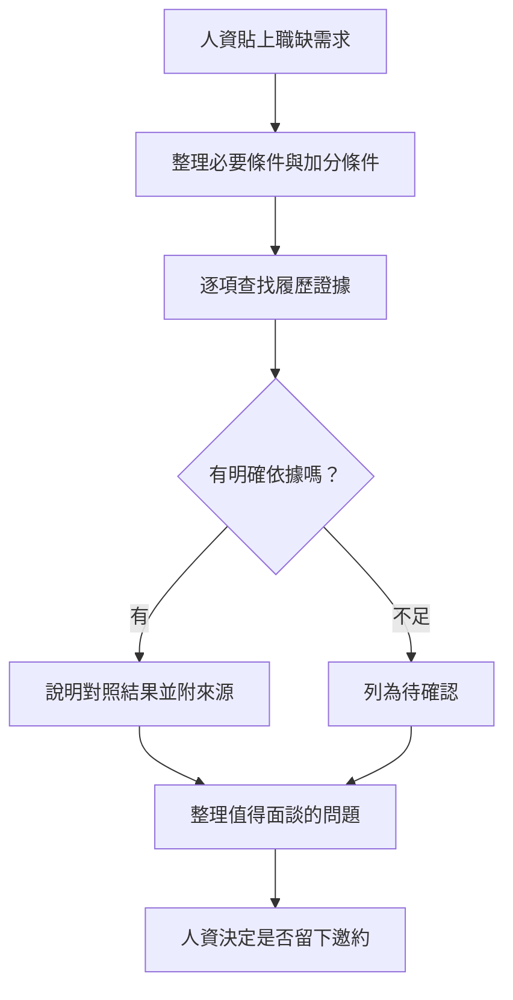

# 安裝後的延伸思考

## 未來 v3.0 可以往哪裡發展？

人資貼上職缺需求（JD）後，機器人能否對照履歷，整理出**符合的條件、還需確認的資訊，以及值得面談的問題**？

這是未來發展方向，尚未實作。可以依自己的興趣，思考是否要增加這項能力。

## 參考流程

找不到證據時，先留下問題讓本人說明；邀約仍由訪客確認後才送出。這個流程可依實際需求調整。

## 值得先想清楚的問題

- **真的有需要嗎？** 現有問答還缺少什麼？新功能能幫誰省下哪些步驟？
- **答案根據什麼？** 每項對照都應有履歷依據；資料沒寫，不代表這個人不會。
- **判斷到哪裡？** 只比較與工作相關的條件。若要評分，規則是什麼？哪些事應留給人資與本人確認？
- **操作是否順暢？** 長職缺怎麼輸入？追問、換職缺或取消時，機器人如何處理？
- **資料怎麼保護？** 職缺內容能否交給 AI？是否保存、多久刪除？不同訪客的資料如何分開？邀約仍應由訪客確認後送出。
- **時間與費用能接受嗎？** 分析要等多久、花多少 API 額度？失敗時怎麼提示與重試？
- **怎麼知道做得好？** 用不同案例核對證據與結論，不能只看回答是否流暢。

## 可以從小地方開始

不必一次完成整套功能。可以先探索「整理職缺條件」「找出對應履歷證據」或「提出面談問題」其中一個方向，再決定是否繼續擴充。

---

## V3 候選實作說明（`feature/v3-job-match`）

- **GitHub 帳號／公開稱呼**：`canlgz`
- **起點版本**：`v2.0.0`（起點 Commit：`54501c9`）
- **實作重點（人資三題式職缺評量、履歷內容品質檢核與 2D 適配熱圖）**：
  1. **Quick Reply「人資」入口與三題式引導**：於底部快速回覆列新增「人資」（`hr:start`）及首頁第三張導覽卡下方按鈕，依序詢問人資三個問題：① 主要工作職稱、② 對應工作技能與深度、③ 具體工作或專案經驗（支援點選「不拘經驗（略過）」或隨時「取消評量」）。
  2. **依文件實際內容品質與證據強度檢核**：不以第一人稱自我推銷或單憑關鍵字給高分，而是以第三人稱客觀人資視角檢驗「技能記載 ↔ 工作經歷／專案實作／具體成果」是否有真實對應關係，明確區分「實質達標」「基礎偏弱（待加強，如僅有小型內部原型或測試資料）」與「不及格（缺乏實質佐證）」。
  3. **分階段回饋與最終三欄式分析＋2D 適配熱圖 Flex 卡片**：
     - 第 1、2 題回答後立即檢索知識庫並回報單題「即時內容品質檢核」與「文件強度判定」。
     - 第 3 題完成後，依序輸出：① 履歷文件內容品質總評與三欄式實質強度分析（具實質證據支撐項目／內容品質落差與不及格項目／鑑別真實強度之面談追問）、② 獨立的資料來源泡泡、③ LINE Flex 2D 適配熱圖卡片（Y 軸：人資需求條件 × X 軸：求職者文件在「技能、經歷、作品、成果」四維度的實質強度，以深色 `● 達標`、中色 `◐ 偏弱`、淺色 `✕ 不及格` 呈現差距）。
- **主要修改檔案**：
  - [gas/Hr.gs](../gas/Hr.gs)：新增人資三題式草稿管理、即時內容品質檢核、多維度 RAG 檢索、結構化評鑑與 2D 熱圖 Flex 卡片。
  - [gas/Line.gs](../gas/Line.gs)：於 `quickReply_()` 加入「人資」按鈕，並於首頁第三張卡頁尾提供「人資適配評量」入口。
  - [gas/Webhook.gs](../gas/Webhook.gs)、[gas/Contact.gs](../gas/Contact.gs)：串接 `handleHr_()` 路由，並確保進入邀約／聯繫流程時清除未完成的人資評量草稿。
  - [scripts/bundle.mjs](../scripts/bundle.mjs)、[dist/Code.gs](../dist/Code.gs)、[START_HERE.html](../START_HERE.html)：將 `Hr.gs` 納入單檔與離線安裝頁打包流程。
  - [test/hr.test.mjs](../test/hr.test.mjs)、[test/homepage.test.mjs](../test/homepage.test.mjs)、[test/quick-topics.test.mjs](../test/quick-topics.test.mjs)：新增人資三步驟與熱圖單元測試，並同步更新 Quick Reply 預期項目。
