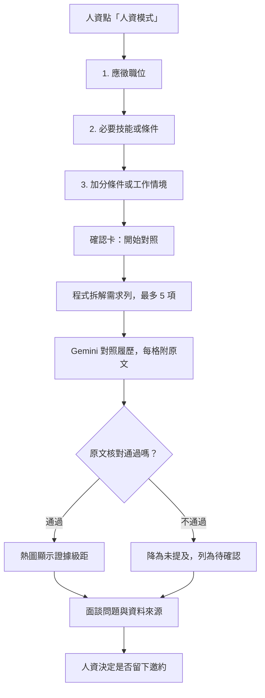

# 安裝後的延伸思考

## 第三版已實作：人資模式

人資點「人資模式」回答三個問題後，機器人對照公開履歷，整理出**技能 × 需求證據熱圖、待確認條件與面談問題**。

## 第三版怎麼回答這些設計問題

- **真的有需要嗎？** 一般問答要人資一題一題問；人資模式三題就能看到所有需求的對應程度。
- **答案根據什麼？** 每個有顏色的格子都必須有履歷原文並通過核對；資料沒寫，不代表這個人不會，所以列為「待確認」而不是「不符合」。
- **判斷到哪裡？** 只分四級證據強度（明確證據、相關經驗、間接、未提及），不給總分、不排名、不承諾錄取。AI 不得依年齡、性別、婚育、宗教、健康、國籍評估或提問。
- **操作是否順暢？** 需求可一次輸入多項；超過 5 項只對照前 5 項。可隨時「取消」、在確認卡「重新填寫」，或按首頁、主題離開。
- **資料怎麼保護？** 職缺內容會交給 Gemini 分析，但只暫存約 30 分鐘，分析後清除，不寫入 Doc、收件匣或執行記錄；不同訪客的草稿以雜湊鍵分開。邀約仍由訪客確認後才送出。
- **時間與費用能接受嗎？** 每次分析固定 1 次向量查詢加 1 次生成呼叫。失敗時保留確認卡，可再按「開始對照」。
- **怎麼知道做得好？** 用不同職缺測試，逐格到 Doc 核對原文；`npm test` 也涵蓋引用造假、格式錯誤、履歷途中被修改等情況。

## 之後還可以往哪裡發展？

- **貼整份職缺說明**：由 AI 先拆出需求，再讓人資確認或刪改，最後才對照。
- **逐項檢索**：每項需求各自找證據，減少漏掉的依據，但等待時間與 API 用量會增加。
- **結果帶入邀約**：把待確認條件帶進「留下邀約」，讓本人回覆時一次說明。

不必一次完成。可以先挑一個方向，想清楚需求、證據、隱私與驗收方式，再決定是否增加。
