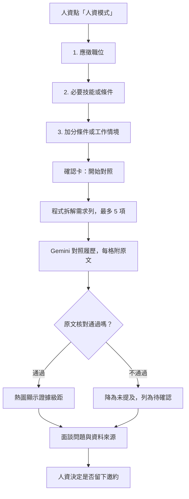

# 安裝後的延伸思考

## 第三版已實作：人資模式

人資點「人資模式」回答三個問題後，機器人對照公開履歷，整理出**技能 × 需求證據熱圖、待確認條件與面談問題**。

## 第三版怎麼回答這些設計問題

- **真的有需要嗎？** 一般問答要人資一題一題問；人資模式三題就能看到所有需求的對應程度。
- **答案根據什麼？** 每個有顏色的格子都必須有履歷原文並通過核對；資料沒寫，不代表這個人不會，所以列為「待確認」而不是「不符合」。
- **判斷到哪裡？** 只分四級證據強度（明確證據、相關經驗、間接、未提及），不給總分、不排名、不承諾錄取。AI 不得依年齡、性別、婚育、宗教、健康、國籍評估或提問。
- **操作是否順暢？** 需求可一次輸入多項；超過 5 項只對照前 5 項。可隨時「取消」、在確認卡「重新填寫」，或按首頁、主題離開。
- **資料怎麼保護？** 職缺內容會交給 Gemini 分析，但只暫存約 30 分鐘，分析後清除，不寫入 Doc、收件匣或執行記錄；不同訪客的草稿以雜湊鍵分開。邀約仍由訪客確認後才送出。
- **時間與費用能接受嗎？** 每次分析固定 1 次向量查詢加 1 次生成呼叫。失敗時保留確認卡，可再按「開始對照」。
- **怎麼知道做得好？** 用不同職缺測試，逐格到 Doc 核對原文；`npm test` 也涵蓋引用造假、格式錯誤、履歷途中被修改等情況。

## v3.1 已實作的三個延伸

- **貼整份職缺說明**：第 2 題按「貼職缺說明」，AI 先拆出必要／加分條件。為了守住「可核對」原則，每項都必須附 JD 原文，程式比對通過才保留；年齡、性別等非工作條件一律略過。JD 原文拆解後即刪除，人資確認或刪改後才對照。
- **確認卡刪改**：每項需求都有「移除」按鈕，另有「修改需求」可回到第 2 題改寫。
- **逐項檢索**：確認卡的「逐項對照」讓每項需求各自找證據，以一次批次請求取得向量，再合併最多 12 段給一次生成。依據較完整，但等待時間與 API 用量會增加。
- **結果帶入邀約**：對照完成後按「帶入邀約」，職位與待確認條件會帶進「留下邀約」第 2 題，讓本人回覆時一次說明；仍須訪客確認送出。

## v3.2 已實作的三個延伸

- **經歷時間軸**：AI 只負責把有日期的段落整理成期間，每筆的原文、年份與月份都要由程式核對；空窗、重疊與短期任職由程式計算，不交給 AI 判斷，也不推測原因。空窗的面談問題只請本人補充工作或學習經歷，並註明不需說明個人原因。
- **成果拆解（STAR）**：從履歷標題選一個專案，四格都只顯示能在該段找到的連續原文；找不到就寫「履歷未提及」並給追問，結果沒有數字時提醒「成果未量化」。
- **轉給主管**：對照完成後由程式組成 300 字內的摘要，不再呼叫 AI；放不下的項目以「等 N 項」表示，並保留「不是錄取分數」的聲明。

## 之後還可以往哪裡發展？

- **結果匯出成圖片**：把熱圖或時間軸輸出成圖片，要先想清楚資料保存與分享範圍。
- **多位求職者比較**：同一份職缺對照多份履歷，但要避免變成排名或錄取分數。

不必一次完成。可以先挑一個方向，想清楚需求、證據、隱私與驗收方式，再決定是否增加。
