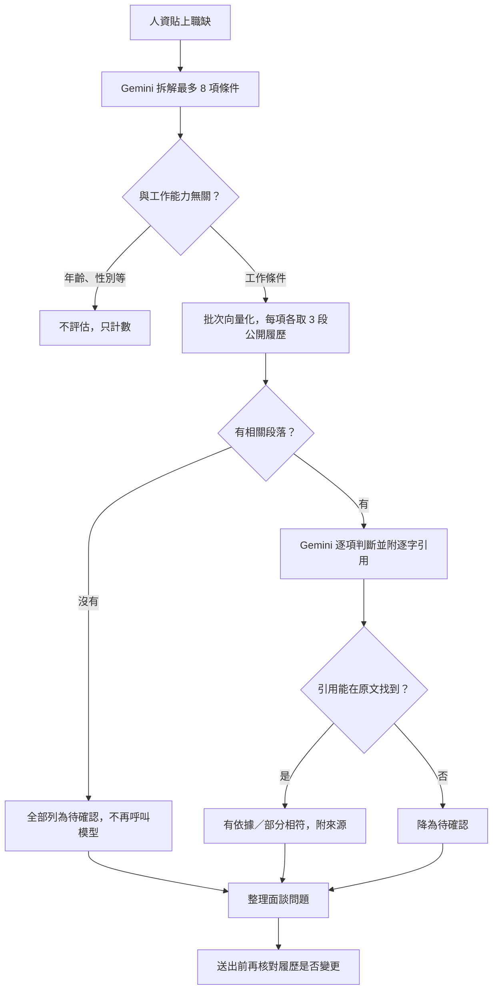

# 職缺對照與 HR 工具（v3.0 候選）

人資貼上職缺需求後，機器人依**公開履歷**逐項整理：有依據的條件、部分相符、待確認的條件，以及值得在面談詢問的問題。之後可以把結果帶進邀約，附上想先請教本人的問題，或直接預約本人開放的面談時段。設計思考的出發點見 [安裝後延伸思考](安裝後延伸思考.md)。

## 怎麼使用

1. 在 LINE 輸入「職缺對照」，或點首頁第三張卡的「職缺對照」按鈕。
2. 10 分鐘內貼上職缺需求，15～2000 字。也可以一次傳送「職缺：」加上內容。
3. 等待約數秒至十幾秒（會顯示處理中動畫），收到結果與資料來源。
4. 想聯繫本人，點結果下方的「用這份職缺留邀約」或「用這份職缺預約面談」；要換一份職缺，點「再對照一份職缺」。

輸入「取消」可離開。貼上前改輸入「首頁」、點主題、作品或聯繫按鈕，也會自動離開。少於 15 字的訊息視為一般提問，交回原本的履歷問答。

## 回覆範例

```text
📋 職缺對照：資料分析師
依公開履歷整理，僅供參考；最終請與本人確認。

✅ 有履歷依據（1）
• ［必要］熟悉 Python 資料處理
  本人使用 pandas 整理資料

❔ 待確認（2）
• ［必要］具備 SQL 經驗
  公開履歷未提供明確資料，建議面談確認
• ［加分］英文簡報能力
  公開履歷未提供明確資料，建議面談確認

💬 建議面談問題
1. 請分享使用 SQL 查詢資料的經驗。
2. 能否分享一個與「英文簡報能力」相關的實際經驗？當時你負責什麼、結果如何？

「待確認」代表公開履歷沒有寫，不代表本人不具備。
```

下一則訊息列出資料來源，例如「資料來源：專業技能」。

## 用這份職缺留邀約：附上想先請教本人的問題

職缺對照完成後，結果下方第一個按鈕是「用這份職缺留邀約」：

1. 「職缺或合作內容」自動帶入職稱與逐項結果，例如：

```text
職缺：資料分析師（由職缺對照帶入）
✅ 熟悉 Python 資料處理
❔ 具備 SQL 經驗
❔ 英文簡報能力
```

2. 第 2 步改問「想先請教本人哪些問題」，並把待確認、部分相符的條件整理成建議問題：

```text
1. 能否說明您在「具備 SQL 經驗」方面的經驗？
2. 能否說明您在「英文簡報能力」方面的經驗？
```

   可按「使用建議問題」、直接輸入自己的問題（500 字內），或「略過」。
3. 接著填回覆方式與時段，確認頁完整顯示全部內容；要改成手動填寫，按「重新填寫」。
4. 送出後，本人收到的 Email、LINE 通知與收件匣都會看到職缺摘要和這些問題，可以先準備說明，再用 HR 留下的方式回覆。

摘要只含職稱與條件清單，不含職缺全文，以雜湊鍵暫存約 30 分鐘；過期時請重新對照，不會猜測內容。輸入「清除對話」可立即清除。

## 預約面談時段

本人先在 GAS「專案設定 → 指令碼屬性」新增 `INTERVIEW_SLOTS`，每行一個時段（台北時間）：

```text
2026-11-10 14:00-15:00
2026-11-12 10:00-10:30
2026-11-13 16:00
```

也可用逗號分隔。到編輯器執行 `listInterviewSlots` 檢查：每個時段會顯示 `open`（可預約）、`booked`（已被預約）或 `past`（已過或不到 1 小時），格式錯誤的項數另外列出。不設定 `INTERVIEW_SLOTS` 時，預約功能不會出現。

HR 的操作：

1. 輸入「預約面談」，或點聯繫卡的「預約面談時段」、職缺對照結果的「用這份職缺預約面談」。
2. 從最近 6 個開放時段中點一個。
3. 填公司與稱呼、職缺內容（從職缺對照來的會改問「想先請教本人的問題」）、回覆方式；「方便聯繫的時段」自動填入所選時段，不必再填。
4. 確認送出後時段即保留，其他人不會再看到。本人的通知會寫「已預約 11/10（二）14:00–15:00（台北時間）」。

規則：

- 只顯示 1 小時後的未來時段；已過期、格式錯誤或不存在的日期（例如 2 月 30 日）不顯示。
- 兩人同時選同一時段時，先送出的人取得時段；後送出的人會收到說明，邀約不會送出，改為請他輸入其他時段。
- 預約只存在本人的私有管理檔，不寫 Doc、不交給 AI。本人在收件匣刪除該邀約即釋出時段；要停止開放某個時段，直接從 `INTERVIEW_SLOTS` 刪掉那一行。
- 系統不會寫入 Google 日曆，也不會自動通知 HR 已確認；保留時段後，仍由本人用 HR 留下的方式確認。

## 處理流程



## 設計取捨

| 問題 | 這版的做法 |
| --- | --- |
| 答案根據什麼？ | 「有依據」「部分相符」必須附上能在公開履歷找到的連續原文，使用與一般問答相同的引用檢查；模型改寫或捏造即降為「待確認」 |
| 判斷到哪裡？ | 不打分數、不判斷是否錄取。年齡、性別、婚姻、國籍、外貌、健康等條件由提示詞與程式雙重排除，只顯示排除項數 |
| 資料沒寫怎麼辦？ | 列為「待確認」，明確說明不代表不具備，並轉成面談問題；不寫入待補充區，避免把職缺條件誤當成履歷缺漏 |
| 長職缺怎麼輸入？ | 上限 2000 字，高於一般問題的 800 字；超過時提示只保留工作內容與條件，並繼續等待 |
| 資料怎麼保護？ | 職缺只在當次送至 Gemini；不寫入 Doc、索引、執行記錄或待補充問題。等待狀態只存「是否等待中」的雜湊鍵旗標約 10 分鐘 |
| 與邀約衝突？ | 開始職缺對照會取消未送出的邀約草稿，避免職缺被填進邀約欄位；邀約仍須訪客確認後送出 |
| 時間與費用？ | 每份職缺約 3 次 API（拆解、一次批次向量、判斷）；沒有相關段落時只要 2 次。失敗時沿用既有錯誤說明，例如額度不足顯示 HTTP 429 |
| 履歷剛改過？ | 分析前後都核對公開內容指紋，未同步時不使用舊索引回答 |

## 驗收

本機：`npm test` 會執行 `test/job-match.test.mjs`，涵蓋完整流程、捏造引用降級、部分相符、排除與工作無關條件、無相關段落、取消／導覽、長度限制、非職缺內容、未同步、邀約草稿衝突、API 錯誤與首頁入口；以及摘要過期與清除。`test/booking.test.mjs` 涵蓋附上給本人的問題（建議、自訂、略過、全部符合時不建議）、時段篩選與解析、預約與保留、兩人搶同一時段、刪除邀約釋出時段，以及從職缺對照預約。

實機：更新原部署為新版本後，在 LINE 依序測試：

1. 「職缺對照」→ 貼上一份與自己履歷相關的職缺，確認符合項目有正確來源。
2. 貼上含有履歷沒寫的條件（例如某種證照）的職缺，確認列為待確認並出現面談問題。
3. 「職缺對照」→「取消」；以及「職缺對照」→「首頁」，確認都能離開。
4. 對照後點「用這份職缺留邀約」，使用建議問題並送出，確認本人的 Email／LINE 通知有職缺摘要和問題。
5. 設定 `INTERVIEW_SLOTS`、執行 `listInterviewSlots`，在 LINE「預約面談」選一個時段送出；再執行一次確認狀態變成 `booked`，並從另一個 LINE 帳號確認看不到該時段。在收件匣刪除這份邀約後，時段應恢復 `open`。
6. 既有功能：「快速一覽」、主題問答、作品圖庫、一份一般邀約。

本機測試模擬 Gemini 與 LINE，不能證明實際模型品質；請用不同職缺核對證據與結論，不能只看回答是否流暢。
